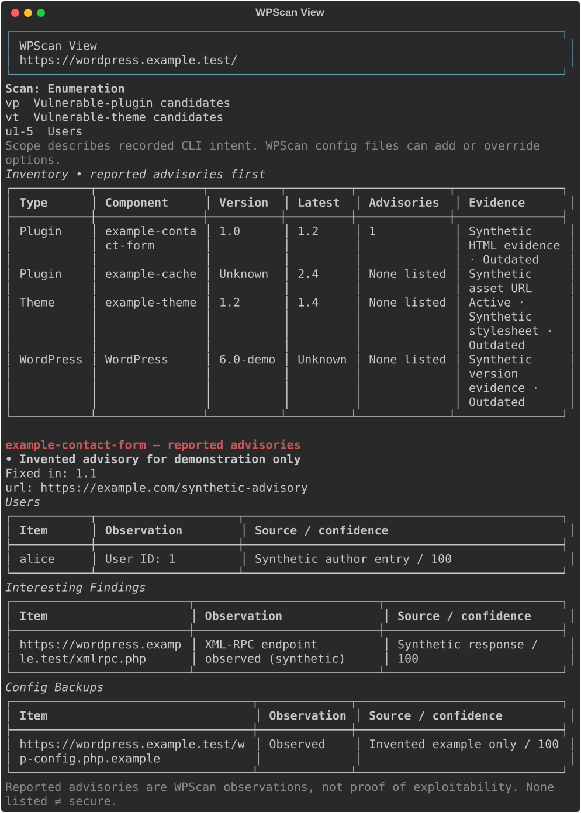

# WPScan View

Turn WPScan JSON into a terminal you can scan at a glance, plus a standalone HTML dashboard. Plugins and themes with reported advisories appear first; core version, active/parent themes, users, exposed files, other findings and detection evidence stay accessible.

The formatter does not contact a target. Its optional `scan` wrapper runs **your installed WPScan** with the arguments you explicitly supply.

## Install and try

Requires Python 3.10+. Install in a virtual environment:

```bash
git clone https://github.com/git-vac/wpscan-view.git
cd wpscan-view
python -m venv .venv
# Linux / macOS / Kali:
source .venv/bin/activate
# Windows PowerShell instead: .\.venv\Scripts\Activate.ps1
python -m pip install .
wpscan-view examples/enumeration.json --html reports/example.html
```

The included scans and advisories are **invented fixtures**, not real vulnerability claims. Open `reports/example.html` for the dashboard. [Example dashboard](examples/report.html) · [Implementation walkthrough](docs/walkthrough.md)



## Pipe a scan directly

```bash
wpscan --url https://example.test --format json | wpscan-view
wpscan --url https://example.test -e vp,vt --format json | wpscan-view --html reports/scan.html
```

Use **comma-separated** choices: `-e vp,vt`, not `-e vp vt`. WPScan's own API and enumeration requirements still apply. The formatter cannot add vulnerability data that WPScan did not supply.

WPScan JSON is produced when its scan finishes, so the report appears at the end, not as a live progress feed. Don't combine its regular console output or stderr with the JSON stream. On older Windows PowerShell, prefer a saved UTF-8 JSON file or the wrapper to avoid native-pipeline encoding conversion.

## Recommended: preserve scanner exit status

```bash
wpscan-view scan --html reports/scan.html -- --url https://example.test -e vp,vt
```

Arguments before `--` belong to the formatter; arguments after it go directly to WPScan, without a shell. The wrapper adds `--format json`, captures stderr privately, and preserves WPScan's nonzero exit status when its JSON can be read. Output/format options for WPScan are refused in wrapper mode; use the formatter's `--html` / `--json` instead. WPScan itself must be installed separately, normally on Kali/Linux.

The wrapper does not stream scanner stderr because it can contain sensitive request details. If WPScan fails before producing JSON, run it separately to inspect its error. The formatter exits 2 when there is no usable JSON. With a shell pipe, use your shell's pipeline failure handling, such as `set -o pipefail` in Bash, to preserve upstream failure.

## Read existing results

```bash
wpscan-view scans/result.json --html reports/result.html --json reports/normalized.json
wpscan-view scans/result.json --details --no-color
wpscan-view scans/older.json --command-line 'wpscan --url https://example.test -e ap,at'
```

| Output | What you get |
| --- | --- |
| Terminal, default | Width-aware tables, advisory details, user and finding tables; color on capable terminals. |
| `--html FILE` | Self-contained dashboard, inventory, advisory references and expandable full evidence. |
| `--json FILE` | Normalized report for automation. |
| `--details` | Full component evidence in the terminal as well. |
| `--no-color` / `NO_COLOR` | Plain terminal rendering for logs and accessibility. |

Output files must be new. Parent folders are created. Input is limited to 16 MiB. Plain WPScan console transcripts, JSONL and SARIF are deliberately rejected rather than partially guessed; ask WPScan for `--format json`.

## How scan detection works

Current WPScan JSON includes `command_line`. The formatter recognizes `-e vp,vt`, `-evp,vt`, `--enumerate vp,vt`, and `--enumerate=vp,vt`, including user/media ranges. A bare `-e` is identified as enumeration with **version-dependent defaults**, not a fabricated exact selection. An absent command line yields **Unknown** scope; you can supply the original invocation yourself.

Scope is **recorded CLI intent**, not proof of effective configuration. WPScan config files, custom plugin/theme lists, and authenticated inventory can change what actually runs. A standard scan is labeled “no explicit enumeration,” not “no plugins exist.”

## Interpret findings accurately

- **Reported advisories** come from WPScan's vulnerability entries. Applicability still needs review, especially with unknown or uncertain installed versions.
- **Outdated** is separate from vulnerable. A version string alone does not establish a vulnerability.
- **None listed** never means secure. API errors, missing API status, excluded advisories, quota exhaustion and incomplete scans are visible warnings.
- Counts describe observed components and advisory entries, not a complete site inventory or unique CVE count.

The HTML escapes scan-supplied text, allows only HTTP(S) reference links, and loads no remote assets or scripts. Terminal rendering treats scan text literally and strips control characters. Known password/token keys are redacted and the raw command line is omitted, but arbitrary banners and URLs may still contain private data. Keep real scans in `scans/` and reports in `reports/` (both Git-ignored); review other files before publishing.

## Development

```bash
python -m pip install -e .
python -m unittest discover -s tests -v
```

Tests cover scan-scope variants, missing vulnerability coverage, theme merging, malicious text, redaction, wrapper status propagation and output protection. CI runs on Linux and Windows with Python 3.10 and 3.12.

Schema checked against WPScan's upstream [JSON templates](https://github.com/wpscanteam/wpscan/tree/master/app/views/json) and [enumeration options](https://github.com/wpscanteam/wpscan/blob/master/app/controllers/enumeration/cli_options.rb). This independent formatter is MIT licensed; WPScan and its API have their own terms.
